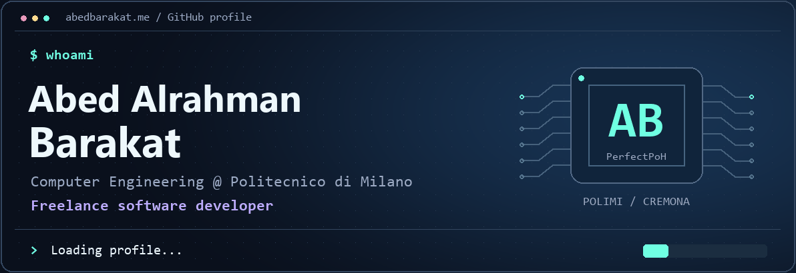
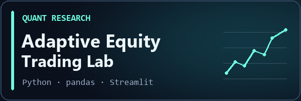
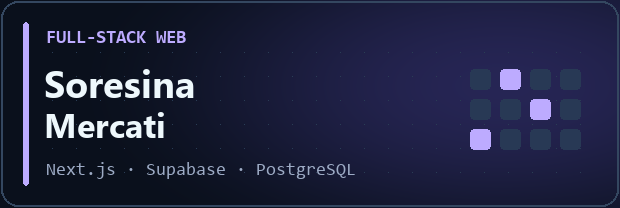
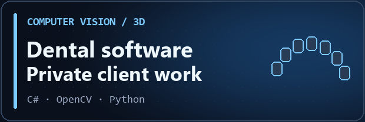
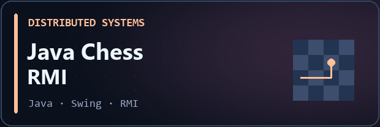
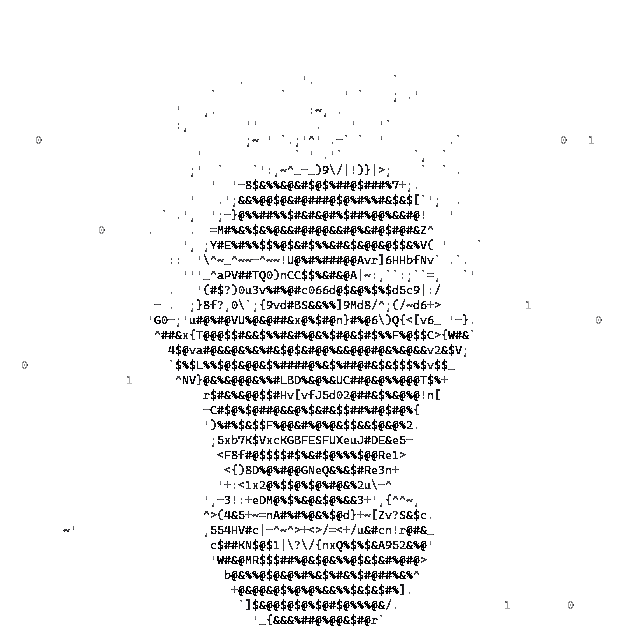

  <picture>
    <source media="(prefers-reduced-motion: reduce)" srcset="assets/abed-profile-hero.png" />
    
  </picture>

   
  <a href="https://abedbarakat.me"><b>Portfolio &amp; CV</b></a> ·
  <a href="https://www.linkedin.com/in/abed-alrahman-barakat-16aa593ba"><b>LinkedIn</b></a> ·
  <a href="mailto:abed@abedbarakat.me"><b>Email</b></a>

## `$ ls ~/projects`

  
  
  
  

## `$ cat ~/about`

I study Computer Engineering at **Politecnico di Milano**, Cremona campus. At **Outside Format**, I work on cephalometric image analysis, dental 3D workflows and API integrations. I reached the final of the **Milano Agentic City Hackathon 2026**.

**Languages** · C# · Java · C/C++ · TypeScript · JavaScript · Python · SQL  
**Tools** · .NET · OpenCV / Emgu CV · Next.js · Supabase · PostgreSQL · Git · Linux

  
<code>$ ./portrait</code>

   
  <picture>
    <source media="(prefers-color-scheme: dark)" srcset="assets/ascii-portrait-dark.gif" />
    <source media="(prefers-color-scheme: light)" srcset="assets/ascii-portrait-light.gif" />
    
  </picture>

